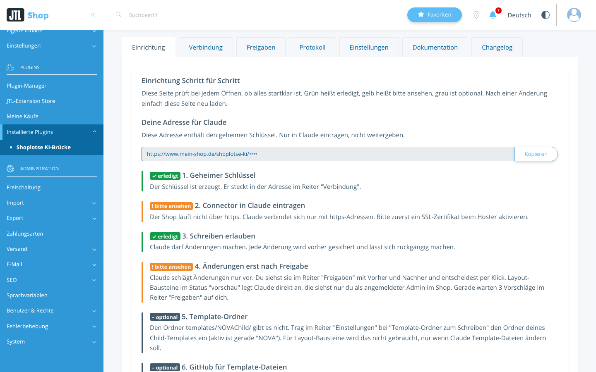
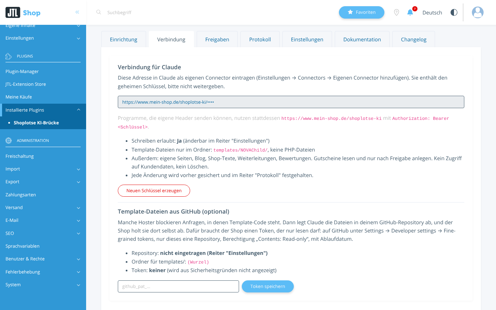
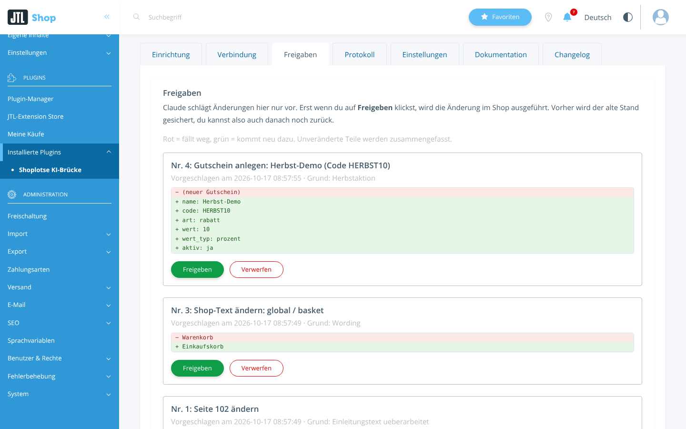

# Shoplotse AI Bridge: MCP server for JTL-Shop 5

Connects **JTL-Shop 5** to AI assistants such as **Claude** through the open **Model Context Protocol (MCP)**. Ask your shop questions in plain language and get answers from your real shop data. Every change waits for your approval in the shop backend.

> This repository is the public info page. The plugin itself is commercial and available at **[shoplotse.net](https://shoplotse.net/en.html)**.

## What you can ask
- "How much revenue did we make last month, and which products sold best?"
- "Where do customers abandon the checkout?"
- "Which products and pages have no meta description?"
- "Which items are running out of stock?"
- "Create a redirect from this old URL to the new category."

## Features
- Revenue, orders and conversion by period
- Checkout and basket drop-offs
- SEO check for products, pages and blog, text suggestions
- Redirects, shop texts, custom pages, blog posts, reviews
- Layout blocks and child-template files
- Shipping, payment methods and stock overview
- Vouchers (always need approval)
- 38 MCP tools, all documented: [tool reference](https://shoplotse.net/docs.html)

## Safety first
- Writing is **off by default**
- With "changes only after approval", every change becomes a proposal with before/after in the backend tab "Freigaben"
- Backup before every change, one-command undo, full log
- Secret endpoint URL with key, optional IP lock
- No customer data access, no deletions
- No server access or hosting ticket needed

## Screenshots
| Setup | Connection | Approvals |
|---|---|---|
|  |  |  |

## Requirements
- JTL-Shop 5 (tested with 5.8.1), PHP 8.2 to 8.4
- An MCP client, tested with Claude (custom connector on claude.ai)

## Connect to Claude
1. Install the plugin in the JTL-Shop backend (Plugin-Manager, upload ZIP).
2. Open the tab "Einrichtung" and follow the steps, then copy the connector URL.
3. On claude.ai: Settings, Connectors, "Add custom connector", paste the URL.

Full guide: [shoplotse.net/docs.html](https://shoplotse.net/docs.html)

## Price
€119 one-time incl. VAT, licence for one shop, 12 months of updates included. [Buy at shoplotse.net](https://shoplotse.net/en.html)

---

## Deutsch
Die **Shoplotse KI-Brücke** verbindet JTL-Shop 5 über den offenen MCP-Standard mit KI-Assistenten wie Claude. Umsätze, Kaufabbrüche, SEO-Lücken und Lager im Chat abfragen, Änderungen nur nach Freigabe im Backend, mit Sicherung und Rückgängig. Infos, Doku und Kauf: **[shoplotse.net](https://shoplotse.net)**

Support: info@shoplotse.net · Anbieter: Spice for Life Vertrieb UG (haftungsbeschränkt), Berlin
